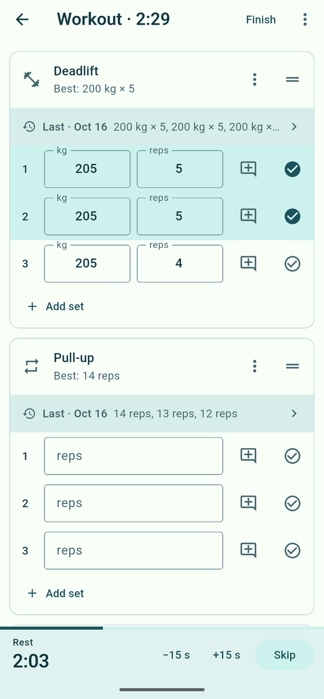
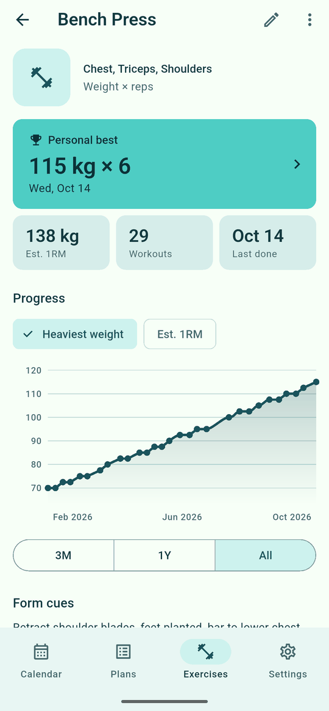
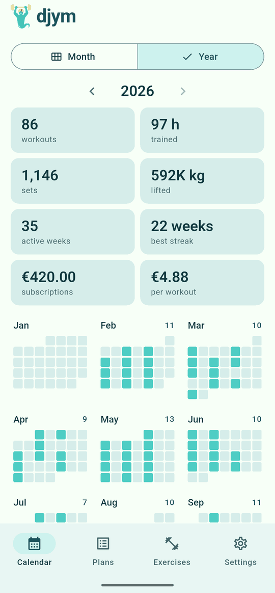
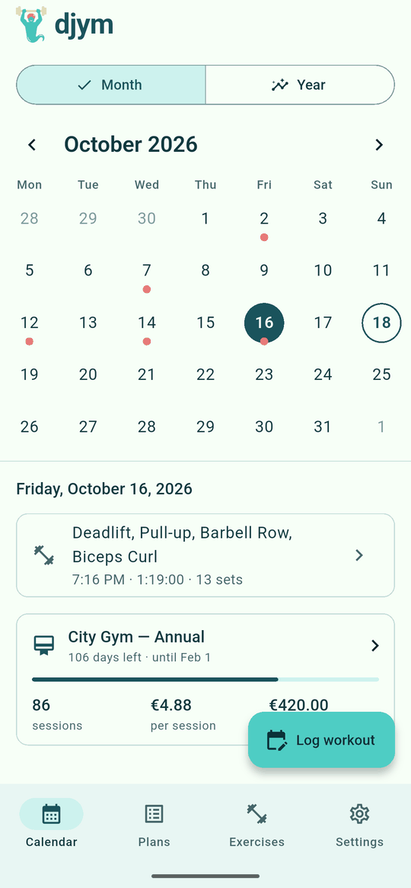
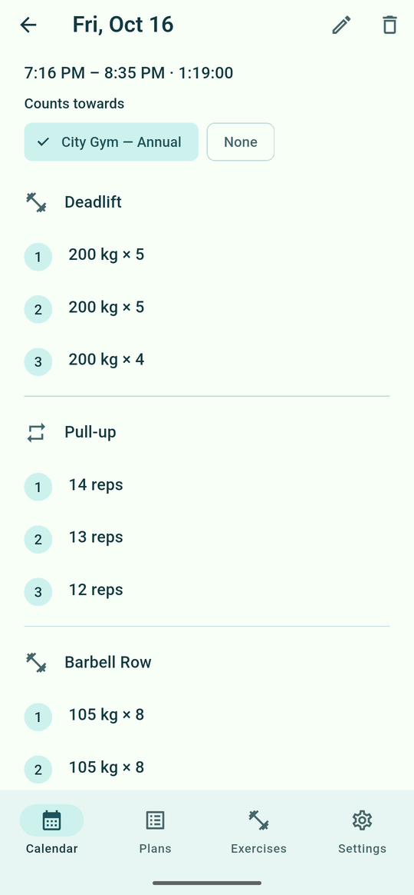
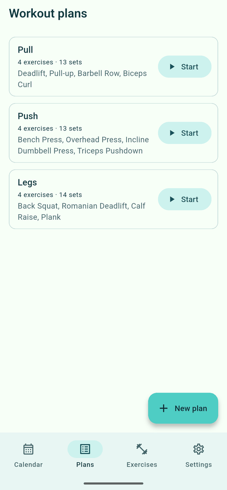
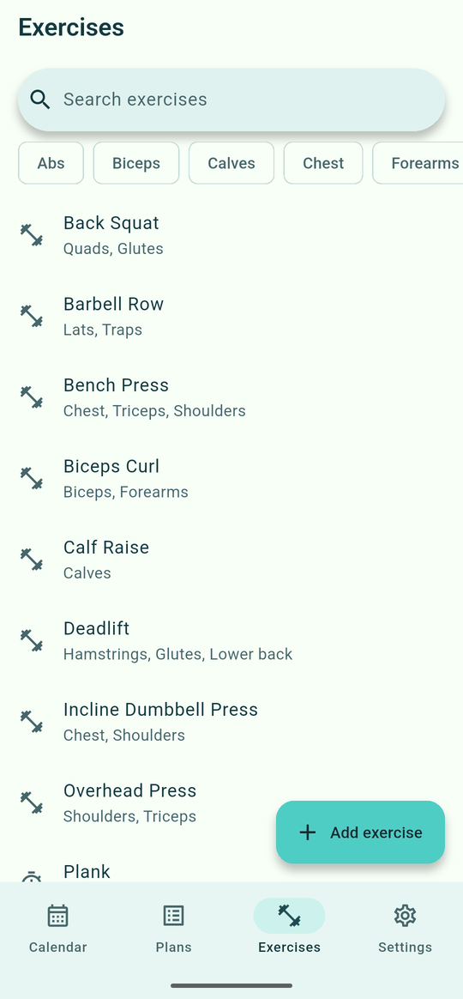
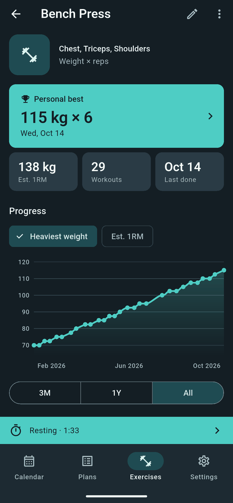

# djym


djym is *djinn* + *gym*: a friendly genie who helps you lift.
A local-first gym logger for Android and iOS.
Plan your workouts, log every set, and watch your lifts go up. No account and no cloud: your data stays on your phone.

| Logging a workout | Exercise progress | Year in review |
|---|---|---|
|  |  |  |

## Features

**Log workouts as you train**
- Start from a plan or an empty workout and tick sets off as you go.
- Each exercise shows what you did last time and your best, so you always know what to beat.
- Track weight × reps, reps only, timed holds, or distance and time.
- A rest timer starts when you finish a set and can alert you even when the phone is locked.
- The screen stays on during a workout.

**See your progress**
- Each exercise shows your personal best, estimated one-rep max and a progress chart.
- The calendar marks every training day, and a year view sums up workouts, hours, volume and streaks.

**Plans and exercises**
- Build reusable plans such as Push, Pull and Legs, with target sets per exercise.
- Search the open [wger](https://wger.de) exercise database, or add your own exercises with muscles, form cues and a photo.

**Gym subscriptions**
- Track memberships and see what each workout really costs you.

**Optional AI assistant**
- Fill in tracking type, muscles and form cues for new exercises automatically.
- Bring your own API key from OpenAI, Anthropic or Gemini. AI stays off until you add one.

**Your data, your phone**
- Everything is stored on the device.
- Export a single backup file, photos included, and restore it on any phone.
- Your API key is kept in the system keystore and never goes into backups.
- Light and dark themes, metric or imperial units, and any currency.

## Screenshots

| Calendar | Workout details | Plans |
|---|---|---|
|  |  |  |
| **Exercise library** | **Dark theme** | |
|  |  | |

## Install

Build the Android APK with [Flutter](https://docs.flutter.dev/get-started/install):

```bash
flutter pub get
dart run build_runner build --force-jit
flutter build apk --release
```

Then install `build/app/outputs/flutter-apk/app-release.apk` on your phone.
